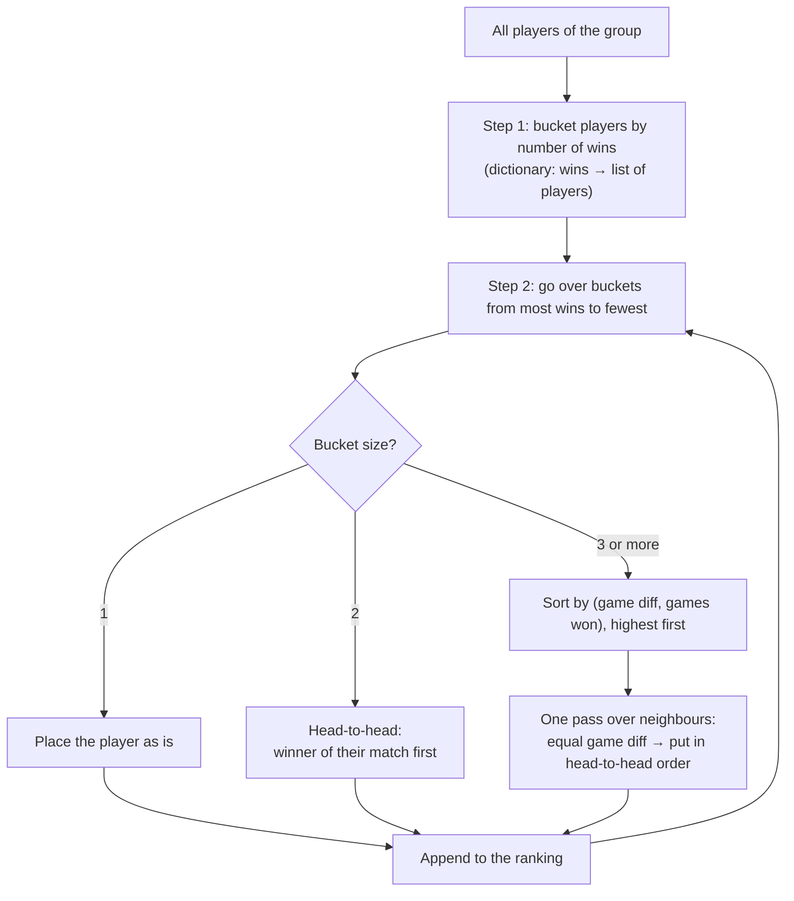

# 🎾 Tennis Tournament Manager

A tennis tournament manager covering the group stage (round robin) and the playoffs, with a CustomTkinter GUI.

```bash
pip install -r requirements.txt     # customtkinter (needs Python built with tkinter)
python -m tennis                    # launch the GUI
python -m unittest discover tests   # run core tests
```

The original CLI script `tennis_group_standings.py` is still here for reference.

## Architecture

```
tennis/
  core/            # pure domain logic, no UI imports, fully unit-tested
    scoring.py     # MatchFormat(games_to_win, tiebreak), Score, parse_score()
    scheduling.py  # round_robin(n): circle/polygon method, any N
    ranking.py     # rank_players(): the original tie-break algorithm (see 'Standings & tie-breaking')
    models.py      # Match, Group, Knockout, Tournament (commands + to/from dict)
    persistence.py # JSON save/load (atomic write)
  gui/
    controller.py  # TournamentController: the only bridge view -> model, observer notify
    app.py         # Setup -> Group Stage -> Playoffs -> Podium screens
tests/test_core.py
```

The views never change the model directly. They call controller commands, the controller
notifies its subscribers, and the active screen re-renders from the model. This MVC
structure means any frontend (CLI, web, Qt) can reuse `core` unchanged.

### User flow
1. **Setup**: tournament name, 1/2/4 groups, group names and **3, 4 or 5 players per group**.
   Every group card has its own format card (**Games to win [2] [3] [6]**, **Enable Tie-Break**, and the
   valid scores underneath). A separate **Playoff Format** card sets the knockout format, and the
   **Qualification** control shows how many players advance (see below). It updates as you type players.
2. **Group stage**: one tab per group. The schedule is listed by round, with resting players shown.
   Rounds are played in order: a round unlocks once every score of the previous round is in. Each
   score field turns green or red as you type and explains any error. Press Enter or tab away to
   save. The standings table (#, Player, P, W, L, Games Won, Games Lost, Game Diff) updates live and
   qualifiers are highlighted. The button to start the playoffs unlocks only when every match has a score.
3. **Playoffs**: the bracket has one column per round (Round of 16 → Quarter-Finals → Semi-Finals →
   Final), plus a 3rd place match (fed by the semi-final losers, or 3rd v 4th of a single group). Winners move forward automatically.
   Changing an earlier result clears every later result that depended on it.
4. **Podium**: Champion, Runner-up and 3rd place (the 3rd place match winner, or the group's
   3rd-placed player in a single group of 3).

### Playoff qualification (`Tournament.advance_options`, `playoff_pairs`)
| Groups | Group sizes | Advance per group | Bracket |
|---|---|---|---|
| 1 | 3 | top 2 | **Final** (1st v 2nd); the 3rd-placed player in the group takes bronze |
| 1 | 4 | top 2 | **Final** (1st v 2nd) + **3rd place match** (3rd v 4th) |
| 1 | 5 | top 2 (default) | **Final** (1st v 2nd) + **3rd place match** (3rd v 4th) |
| 1 | 5 | top 4 (option) | **Semi-Finals**: 1st v 4th, 2nd v 3rd → Final + 3rd place |
| 2 | any | top 2 (default) | **Semi-Finals**: A1–B2, B1–A2 → Final + 3rd place |
| 2 | both exactly 5 | top 4 (option) | **Quarter-Finals**: A1–B4, B2–A3 → SF1; B1–A4, A2–B3 → SF2 |
| 4 | any | top 2 (default) | **Quarter-Finals**: A1–B2, C1–D2 → SF1; B1–A2, D1–C2 → SF2 |
| 4 | all exactly 5 | top 4 (option) | **Round of 16**: 1st v 4th and 2nd v 3rd of another group |

Players from the same group are placed in opposite halves of the bracket, so a group's top two can
only meet in the Final. In the Round of 16, a group's four qualifiers are in four different quarters.

Save (Ctrl+S) or open a tournament as JSON at any point to pause and resume it.

---

## Match format (`core/scoring.py`)

Every match is **one set**, entered as the games each player won (`6-4`, player 1 first).
`MatchFormat(games_to_win, tiebreak)`:

| Games to win | Tie-break off (sudden death) | Tie-break on (win by two at N-1 all, deciding game at N-N) |
|---|---|---|
| 2 | 2-0, 2-1 | 2-0, 3-1, 3-2 |
| 3 | 3-0, 3-1, 3-2 | 3-0, 3-1, 4-2, 4-3 |
| 6 | 6-0 … 6-5 | 6-0 … 6-4, 7-5, 7-6 |

Anything else is rejected with a reason, e.g. `3-2` with tie-break on: *"At 2-2 a player must win
by two: 4-2, or 4-3 after the tie-break game"*. Level scores, unfinished matches and games played
after the match was over are all rejected. A score is required for every match: there is no
"skip" option, and the next round, the playoffs and the podium stay locked until scores are in.

## Standings & tie-breaking: the core algorithm (`core/ranking.py`)

Ranking the players of a group, especially when several of them have the same number of wins, is
the heart of this project. The algorithm was designed in the original script
(`tennis_group_standings.py`), in `rank_players()` and `get_h2h_winner_and_loser()`. The new code
keeps the same function names and the same flow, so it can be read and explained side by side with
the original.

### 1. The problem

In a round robin every player plays every other player once. The table is ordered by **wins**, but
ties are common in small groups (3–5 players): with 4 players it is easy for two or three players to
finish with 2 wins each. A tie-breaking rule has to decide the order, and it must:

- be **fair**: if two players are tied, the one who won their match against each other should usually
  be ahead;
- be **deterministic**: the same results always produce the same table;
- **never crash**, including while the group is still in progress (the table is shown live).

### 2. Input data

Ranking works on two structures, both built by `tally(players, matches)` from the match results:

**Player rows** (`StandingRow`, the equivalent of the original `Player` class):

| Field | Meaning |
|---|---|
| `name` | player name |
| `wins`, `losses`, `played` | match counts |
| `games_won`, `games_lost` | total games over all matches |
| `game_diff` | `games_won - games_lost` (computed property) |

**Head-to-head dictionary**: who beat whom, and by what score:

```python
head_to_head = {
    ("Dan", "Ron"): (6, 4),     # key: (player 1, player 2) -> (games p1, games p2)
    ("Ron", "Avi"): (7, 5),
    ...
}
```

Each match is stored once, under the order in which the players were scheduled, exactly like
`play_rounds()` built it in the original. `tally()` reads only the played matches, so it is safe to
call at any moment.

### 3. The algorithm, step by step

The code snippets below are shortened to show the idea; the crash guards in the real code are
explained in section 6.



#### Step 1: Group players by wins (bucketing)

```python
tied_win_groups_dic = {}
for player in players_group:
    current_list = tied_win_groups_dic.get(player.wins, [])
    current_list.append(player)
    tied_win_groups_dic[player.wins] = current_list
```

A dictionary maps each number of wins to the list of players who have it, for example
`{2: [A, B, C], 0: [D]}`. This is **bucketing** (grouping by key): one pass over the players, with
O(1) work per player. Players in different buckets never need to be compared with each other,
because more wins always ranks higher.

#### Step 2: Walk the buckets from most wins to fewest

```python
for wins in sorted(tied_win_groups_dic.keys(), reverse=True):
    tied_group = tied_win_groups_dic[wins]
```

Sorting only the keys (at most a handful of distinct win counts) gives the order of the buckets.
Each bucket is then resolved on its own and appended to the final ranking.

#### Step 3: A bucket of one player

No tie: the player is placed directly.

#### Step 4: A bucket of two players: head-to-head

```python
winner, loser = get_h2h_winner_and_loser(tied_group[0], tied_group[1], head_to_head)
ranked_players.extend([winner, loser])
```

`get_h2h_winner_and_loser()` looks up the match in the dictionary. Because the match was stored
under one order only, it tries **both key orders**, `(p1, p2)` and then `(p2, p1)`, and swaps the
score when it finds the reversed key. Each lookup is O(1). Between exactly two players, head-to-head
is the fairest rule: they played each other, and that result decides it, even if the loser has a
much better game difference.

#### Step 5: A bucket of three or more players: sort, then correct with head-to-head

Head-to-head alone cannot order three players, because the results can be circular (A beat B, B beat
C, C beat A). So this case works in two phases.

**Phase 1: sort by a composite key.**

```python
tied_group.sort(key=lambda p: (p.game_diff, p.games_won), reverse=True)
```

The key is a **tuple**. Python compares tuples lexicographically: first by game difference, and
only if that is equal, by games won. `reverse=True` puts the highest values first. Python's sort
(Timsort) is **stable**: players whose keys are completely equal keep their original order, which
is the order they were registered in.

**Phase 2: one pass of neighbour correction.**

```python
for i in range(len(tied_group) - 1):
    p1, p2 = tied_group[i], tied_group[i + 1]
    if p1.game_diff == p2.game_diff:
        winner, loser = get_h2h_winner_and_loser(p1, p2, head_to_head)
        tied_group[i], tied_group[i + 1] = winner, loser
```

The loop walks over each pair of neighbours, left to right. If two neighbours have the **same game
difference** (the sort could not really separate them), their head-to-head result decides who goes
first, and they are swapped if needed. This is similar to **one pass of bubble sort**, with
head-to-head as the comparison, applied only where the main criterion was tied.

### 4. Algorithmic techniques used

| Technique | Where | Why |
|---|---|---|
| Bucketing / grouping with a dictionary | Step 1 | Splits the problem into independent ties in one O(n) pass |
| Sorting keys in descending order | Step 2 | Processes buckets from best to worst |
| Hash-map lookup with symmetric keys | `get_h2h_winner_and_loser` | Finds any match in O(1), whichever player was listed first |
| Stable sort with a composite (tuple) key | Step 5, phase 1 | Orders by two criteria at once; ties keep a predictable order |
| Single bubble-sort-style pass with a custom comparison | Step 5, phase 2 | Fixes neighbours that the numeric criteria could not separate |
| Guard clauses with a fallback | `get_h2h_winner_and_loser` returns `None` | Never crashes on missing data |

**Complexity.** With *n* players and *m* played matches: `tally()` is O(m), bucketing is O(n),
sorting is O(n log n), and the neighbour pass is O(n). The total is **O(m + n log n)**. A group has at most 5
players and 10 matches, so the ranking is instant and can safely run after every keystroke.

### 5. Worked examples

All of these examples are unit tests in `tests/test_core.py` (`TieBreakTests`), so the tables below
are exactly what the program produces. Notation: "A–B 6-5" means A beat B 6-5.

#### Example 1: Two-way tie, decided by head-to-head

Results: A–B 6-5, B–C 6-0, B–D 6-0, C–A 6-0, A–D 6-5, D–C 6-0.

| Rank | Player | W | Games won | Games lost | Game diff |
|---|---|---|---|---|---|
| 1 | A | 2 | 12 | 16 | −4 |
| 2 | B | 2 | 17 | 6 | +11 |
| 3 | D | 1 | 11 | 12 | −1 |
| 4 | C | 1 | 6 | 12 | −6 |

The buckets are `{2: [A, B], 1: [C, D]}`. A and B are a two-player bucket, and A beat B, so **A is
first even though B's game difference is 15 games better**. Among C and D, D beat C.

#### Example 2: Three-way tie, decided by game difference

Results: A–B 6-5, B–C 6-5, C–A 6-0, and A, B, C each beat D 6-0.

| Rank | Player | W | Games won | Games lost | Game diff |
|---|---|---|---|---|---|
| 1 | C | 2 | 17 | 6 | +11 |
| 2 | B | 2 | 17 | 11 | +6 |
| 3 | A | 2 | 12 | 11 | +1 |
| 4 | D | 0 | 0 | 18 | −18 |

A, B and C beat each other in a circle, so head-to-head cannot decide. The sort orders them by game
difference (+11, +6, +1). All the differences are different, so the neighbour pass changes nothing.
Note that A beat B but is ranked below B: in a bucket of three or more, **game difference comes
first**, and head-to-head is used only between neighbours with an equal difference.

#### Example 3: Three-way tie where head-to-head swaps two neighbours

Results: A–B 6-0, B–C 6-1, C–A 6-1, A–D 6-5, B–D 6-0, C–D 6-1.

| Rank | Player | W | Games won | Games lost | Game diff |
|---|---|---|---|---|---|
| 1 | B | 2 | 12 | 7 | +5 |
| 2 | C | 2 | 13 | 8 | +5 |
| 3 | A | 2 | 13 | 11 | +2 |
| 4 | D | 0 | 6 | 18 | −12 |

1. Sort by (game diff, games won): **C (+5, 13)**, **B (+5, 12)**, A (+2, 13).
2. Neighbour pass, i = 0: C and B have the same difference (+5). B beat C 6-1, so they swap:
   **B, C**, A.
3. Neighbour pass, i = 1: C (+5) and A (+2) differ, so there is no change.

#### Example 4: Everything equal (a full circular tie)

Results: A–B 6-3, B–C 6-3, C–A 6-3, and A, B, C each beat D 6-3. A, B and C all have 2 wins, 15
games won, 12 lost (+3).

The sort cannot separate them, so (stable sort) they stay in **registration order**, and then the
neighbour pass runs:

| Registration order | After the sort | Pass i = 0 | Pass i = 1 | Final |
|---|---|---|---|---|
| A, B, C, D | A, B, C | A vs B: A won → A, B, C | B vs C: B won → A, B, C | **A, B, C, D** |
| C, B, A, D | C, B, A | C vs B: B won → B, C, A | C vs A: C won → B, C, A | **B, C, A, D** |

This shows two properties of the method. First, in a perfect circle the result depends on the
starting order. Second, each player is compared only with their neighbours, so in the second line B and A are never
compared directly. In a real tournament a perfect circle with identical scores is very rare, and
any other difference in games decides the order earlier.

#### Example 5: Live table in the middle of the group (crash guard)

Only two matches played: A–B 6-4 and C–D 6-0.

| Rank | Player | W | Games won | Games lost | Game diff |
|---|---|---|---|---|---|
| 1 | C | 1 | 6 | 0 | +6 |
| 2 | A | 1 | 6 | 4 | +2 |
| 3 | B | 0 | 4 | 6 | −2 |
| 4 | D | 0 | 0 | 6 | −6 |

A and C both have 1 win, but they **have not played each other yet**. The original
`get_h2h_winner_and_loser()` would raise `KeyError` here and stop the program. The new version
returns `None`, and the two-player bucket falls back to *(game difference, games won)*: C (+6) is
ahead of A (+2). The same happens for B and D.

### 6. What changed from the original, and what did not

**Unchanged:** the order of the steps, the bucketing by wins, head-to-head for two players, and the
sort plus single neighbour pass for three or more. The function names are also unchanged.

**Adapted:**
- **Games instead of sets.** A match is now a single set, so "sets won / lost / difference" became
  "games won / lost / difference". The head-to-head dictionary keeps the same shape, with game
  scores instead of set scores.
- **Guards.** `get_h2h_winner_and_loser()` returns `None` instead of crashing when the players have
  not met (or if a score were level). A two-player bucket then falls back to (game diff, games won).
  In a three-or-more bucket, those neighbours simply keep their sorted order.
- **Recomputed, not accumulated.** The original added to the counters (`player.wins += 1`) as results
  were typed in. Entering a result twice would count it twice. Now `tally()` rebuilds every row and
  the head-to-head dictionary from the saved match results each time the table is shown, so editing a
  score is always safe.

### 7. Where to find it

| What | Where |
|---|---|
| Counting wins, games and building `head_to_head` | `tally()` in `tennis/core/ranking.py` |
| Head-to-head lookup | `get_h2h_winner_and_loser()` in `tennis/core/ranking.py` |
| The ranking algorithm | `rank_players()` in `tennis/core/ranking.py` |
| Tally + rank + number the rows 1..n | `compute_standings()`, called by `Group.standings()` |
| Tests for every example above | `StandingsTests` and `TieBreakTests` in `tests/test_core.py` |
| The original version | `rank_players()` and `get_h2h_winner_and_loser()` in `tennis_group_standings.py` |

### 8. Possible extensions

Ideas for a later version, if a stricter rule is wanted for ties of three or more:
- compare every pair in the tied bucket (not only neighbours), for example by counting head-to-head
  wins inside the bucket ("mini-league");
- repeat the neighbour pass until nothing changes (a full bubble sort with the head-to-head
  comparison) instead of a single pass;
- add a final, explicit tie-breaker (such as a draw) instead of relying on registration order.

---

## Code review of the original script

### Bugs found
| Where | Problem | Now |
|---|---|---|
| `play_rounds` | A win was counted only if a player had **exactly 3**; any other score gave nobody the win. | Single-set game scores, validated against the format; the winner is whoever has more games. |
| `play_rounds` / `play_knockout_match` | No input validation: `int(input())` crashes on typos, and a level knockout score gives the win to player 2. | `parse_score()` rejects malformed and impossible scores with a message. |
| `get_h2h_winner_and_loser` | `KeyError` if the two players haven't played each other. | Returns `None`; `rank_players()` handles it (see above). |
| main | `players_list = [g1 + g2]` is unused. Duplicate names silently break the name-keyed `head_to_head`. | Setup rejects duplicate names (case-insensitive). |

### Scheduling (`core/scheduling.py`)
The circle (polygon / Berger) method: fix player 0 and rotate the others. Odd N adds a phantom BYE,
so each round shows who rests. Home/away orientation alternates. This produces N-1 rounds (even N)
or N rounds (odd N), covers every pair exactly once, and no one plays twice in a round. This is
verified for N = 3, 4, 5.

### Persistence (`core/persistence.py`)
Every model has `to_dict`/`from_dict`, and the file includes a `version` field (now 3; files
saved by older versions are refused with a clear message). Writes go to a temp file followed by `os.replace` (atomic), so a crash can't corrupt a save.
**SQLite option**: use tables `tournament`, `player`, `group`, `match(id, stage, round, p1, p2, score_json)`.
Make `persistence` an interface (`Repository.save/load`) with `JsonRepository` and `SqliteRepository`
implementations so the controller doesn't care which is used. SQLite becomes worthwhile when you want
history across many tournaments or player statistics.

### Domain models (`core/models.py`)
- `Match` is the single source of truth. Standings are **derived** on demand from match results
  instead of being mutated counters, so editing or correcting a score can never double-count. In
  the old script, re-entering a result would add the counters twice.
- `Group` owns its players, schedule and `standings()`. `Knockout` owns the bracket and its
  winner/loser propagation. `Tournament` validates setup (unique names, group sizes, group count),
  routes commands, and locks the group stage once the playoffs start (it can be reopened explicitly).
- `Knockout` is a generic single-elimination bracket for 2, 4, 8 or 16 players: match *j* of a round is
  fed by the winners of matches *2j-1* and *2j* of the previous round. Seeding is in the table above.

### Further ideas
- Undo/redo with a command stack in the controller.
- Export standings and the bracket to PDF/CSV, and add a dark/light theme toggle.
